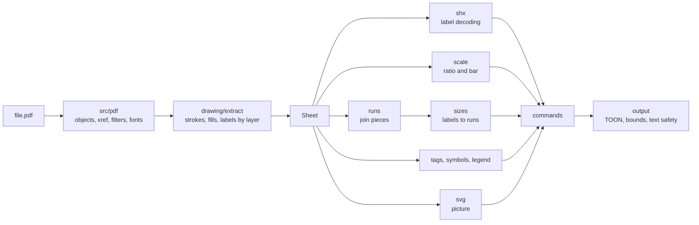

# drawing-axi: design for Comis

| | |
| --- | --- |
| Status | Built and merged. 0.1.0 passes its tests and the live gate on eight real sheets (2026-11-20). Release and the Comis pack are in the [master plan](drawing-axi-master-plan.md). |
| Date | 2026-11-20 |
| Implementation plan | `drawing-axi-implementation-plan.md` |
| Master plan | `drawing-axi-master-plan.md` |
| Live test | `test/live/drawing-live.mjs`; plans and reports stay outside the repository |

## 1. Summary

An owner sends their chief of staff a tender drawing and asks for a bill of quantities for plumbing and fire protection. The drawing is a PDF plotted from a CAD program. Today a Comis worker reads it with a text extractor and a rendered image. It sees no layers and no pipe labels, so it measures by colour and counts by eye. On a real sheet that produced a bill that was wrong by 30 to 90% on four of six systems; its own notes called the lengths rough estimates and asked for the CAD file.

The file holds much more than the picture shows. It keeps the drawing's named layers, one per system, and every label as hidden text with its position. `drawing-axi` is a command-line tool that reads those. It reports layers, labels, the scale, the length of pipe by layer and size, riser tags, symbols, and which layer each legend line stands for. On eight real sheets every measured system came within 10% of a person's takeoff, in under a second per sheet.

The tool holds geometry and no trade knowledge. Which layer is sewer, what goes in which chapter of the bill, and what to ask the owner belong to a Comis skill.

## 2. What a CAD-plotted PDF holds

These facts were checked on eight sheets from one design office: plumbing and fire plans of a residential project, four basement levels, plotted at 1:100 on 1300 x 900 mm sheets by AutoCAD LT 2026. Each file is one page of 1 to 1.5 MB.

| ID | Fact | Consequence |
| --- | --- | --- |
| F1 | **Layers survive.** Each sheet has 73 to 143 optional content groups, named as the CAD layers were. Content is wrapped in `/OC /name BDC … EMC`. Layers from referenced files keep the file's name as a prefix. | Systems can be told apart by layer, not by colour. |
| F2 | **Stroke-font text survives as comments.** Every text drawn with a CAD stroke (SHX) font is also kept as a square comment whose author names the font technology. It has the text and a box. There are 254 to 1,406 per sheet. A comment has no layer. | Every pipe label can be read exactly, with its position. Text extractors do not read comments. |
| F3 | **Control codes are stored as typed.** `%%C` is the diameter sign, `%%D` the degree sign, `%%P` plus-minus. | Decode them. |
| F4 | **Hebrew stroke fonts take Latin keys.** `mbr, nho erho` is "cold water pipe" typed on an Israeli keyboard. The font draws right to left, so digits and Latin letters inside are stored back to front (`02X002` is 200X20), and brackets face the other way. | Decode by key map, then put digit runs back in order. Latin text on the same sheet must be left alone. |
| F5 | **Older fonts take DOS Hebrew bytes.** They reach the file as Windows-1252 punctuation in the order shown on the sheet. Bytes with no Windows-1252 character are lost. | Decode what is there; mark nothing as certain. |
| F6 | **Font text is in the content stream, and may be useless.** On these sheets the fonts' Unicode maps are wrong, so every extractor prints nonsense for the architect's text. Linetype letters (F, S, HF) are font text too. | Stroke-font comments are the reliable labels. Font text is read, and kept apart. |
| F7 | **Dashes are plotted one by one.** A dashed pipe is thousands of separate strokes: 3,116 on one rain layer. The ink is 20 to 50% shorter than the pipe. | Join the pieces of a line and measure end to end. |
| F8 | **Lines are broken for letters.** A fire line leaves a gap of up to about 8 mm on paper for each F. | Join across gaps that size. |
| F9 | **Plots are off scale.** The printed scale bar's 10 m measures 279.84 points, 98.7% of 1:100. | Take the ratio from the title block, and the factor from the bar. |
| F10 | **A scale bar is lines and hatching.** Two long edges with hatched cells between them, not filled boxes. | Find it by its alternating cells, whatever they are drawn with. |
| F11 | **A label sits beside its pipe.** Label boxes are padded: 13 points for text 8 points high. The pipe passes 4 to 6 points from the box's centre. Pipes of other systems often pass straight through the text. | The nearest line to a label is often not its pipe. A label sizes the line beside it, not the line under it. |
| F12 | **Pressure pipes carry no size along the run.** Gravity pipes are labelled with size and slope every few metres. Fire and water mains show their size at risers. | Unlabelled pipe must stay unsized, not be given a neighbour's size. |
| F13 | **Legend samples are drawn on the system's layer.** The line beside "cold water pipe" in the legend is on the cold water layer. Its colour may differ from the lines in the plan. | Pairing captions with samples maps layers to systems in the drawing's own words. Colour still needs a look. |
| F14 | **Risers have tags.** An identifier with the size written under it, inside one symbol: 155 on one sheet. | Pair them and count per size. |
| F15 | **Files have defects.** One stream in each file declares the wrong length; a common extractor prints errors and carries on. | Trust a length only when the end marker follows it. |

**What was measured.** The live test (§11) compares run lengths with a person's takeoff of the same project, by system and floor. All 17 comparisons on five sheets are within 10%. The largest differences are 9.7% and 9.2%; half are under 4%.

| Sheet | System | Tool against the person |
| --- | --- | --- |
| Level -1 ceiling | Sewer, gravity | +0.8% |
| | Rainwater | +3.2% |
| | Fire | -3.9% |
| | Sprinklers | +9.2% |
| | Cold water | +2.6% |
| | Drainage | -9.7% |
| Level -2 ceiling | Rainwater, fire, drainage | +6.1%, +1.3%, 0% |
| Level -3 ceiling | Rainwater, sprinklers, cold water | -6.2%, -2.7%, +0.3% |
| Level -4 ceiling | Rainwater, air | -6.1%, -1.7% |
| Level -4 floor | Sewer, sewer under pressure | -5.4%, -5.6% |

The systems range from 3 m to over 600 m a sheet, about 3,400 m in all. The lengths themselves belong to the project and are not printed here.

By size, on the level -1 ceiling: sewer Ø160 came to 101% of the person's figure, sewer Ø200 to 123%, and fire 3" to 101%. Rain Ø200 came to 74%, with the rest of that pipe left unsized.

**Limits of this evidence.** All eight sheets come from one office and one project. The person's takeoff is older than the sheets by nine months. The layers for each system were chosen with the legend and the person's totals in view. Drawings from other offices are the first thing to test next (master plan M8).

## 3. What Comis and the AXI principles require

### 3.1 Comis

- **Bash is the interface.** A capability is a command plus a skill. Comis prefers an AXI to a general CLI, and writes a new AXI only where no CLI or MCP path exists. None exists for this: the open-source takeoff tools found are desktop programs, and the AXI catalog holds no drawing tool.
- **Skills hold domain knowledge.** The tool measures. The skill knows what a bill of quantities is.
- **Claim nothing unmeasured.** A length the file does not support is absent, not estimated. A run with no size is reported as unsized.
- **Every dependency is attack surface.** One runtime dependency, pinned exactly, as in the other Comis AXIs.
- **Input is untrusted.** A drawing comes from outside. Its text reaches a model.
- **Commands have a deadline.** Comis sets `COMIS_DEADLINE` for every shell call.

### 3.2 The ten AXI principles

| Principle | Here |
| --- | --- |
| Compact TOON output | Every command; the official encoder, pinned |
| A few fields per row | List rows have three to five fields |
| Truncation with the size and a `--full` hint | Long text is cut with its length; rows dropped to fit are counted |
| Total counts | "14 of 134 layers" |
| An explicit empty state | "0 labels match", with what to try |
| Structured errors on stdout, exit 0, 1, 2 | `message`, `code`, `usage`; 14 closed codes |
| A home view with live data | The PDF files in the working folder, with pages, sheet size, layers and comments |
| Next-step hints | One to three `Run …` lines, each a real command |
| Short help per subcommand | `--help` and `help <command>` from one command table |
| No interaction | Flags only; nothing is read from stdin |

## 4. Options considered

| Option | Verdict |
| --- | --- |
| A. The general document tools: `pdftotext`, a table extractor, OCR, a rendered image | Rejected. None reads layers (F1) or comments (F2). This is today's route and the cause of the wrong bill. |
| B. A vision model on the rendered sheet | Rejected as the main path. At sheet scale the labels are a few pixels high, and a picture cannot be measured. Kept as a check: `render` draws a crop for the model to look at. |
| C. A Python script inside a skill, on the PDF library already in the workbench | Works: the first prototype was this. Rejected because a skill script is not versioned, attested or tested as a product, and each install would carry its own copy. |
| D. An AXI on a general PDF library | Rejected. The library's drawing-operator list is an internal format that changes between versions; it brings tens of megabytes and an optional native canvas package into the pack's lock. |
| **E. An AXI with its own small PDF reader** | **Chosen.** The tool needs a narrow slice of PDF: objects, cross-reference data, Flate, path operators, optional content and comments. That is about 1,400 lines. Where the reader refuses a file, the error names the `qpdf` command that rewrites it, and `qpdf` is in the Comis workbench. |
| F. Read DWG or DXF instead | Later. It is the better source when the CAD file is at hand, but tenders hand out PDFs. |

## 5. Architecture

- **`src/pdf/`** reads a file into objects and decoded streams. It knows nothing about drawings.
- **`src/drawing/extract.ts`** walks one page's content and returns a `Sheet`: every stroked and filled path with its layer, colour and width, in sheet coordinates, and every label.
- **The rest of `src/drawing/`** are pure functions from a `Sheet` to an answer. Each has a unit test against a sheet whose answer is known.
- **`src/commands/`** turn flags into those calls and results into rows.
- **`src/cli/` and `src/output/`** are the AXI runtime shared in shape with `ituran-axi` and `priority-axi`: one command table, strict parsing, TOON with size bounds, text safety.

**Sheet coordinates.** Positions are points from the top-left corner of the page as a viewer shows it, x right and y down, after the page's rotation, crop box and user unit. A picture drawn by `render` uses the same numbers, so a model can point at what it sees.

## 6. Command surface

| Command | Answers |
| --- | --- |
| `drawing-axi` | Which drawings are in this folder? |
| `info <file.pdf>` | What does this sheet hold, and what is missing? |
| `scale <file.pdf>` | What is the scale, and how was it found? |
| `legend <file.pdf>` | Which layer and colour does each legend line stand for? |
| `layers <file.pdf>` | Which layers carry long runs? `--split` shows each colour of a layer. |
| `labels <file.pdf>` | What does the sheet say? `--match`, `--each`, `--sizes`, `--source`. |
| `tags <file.pdf>` | Which risers are tagged, with what size? |
| `runs <file.pdf> --layer …` | Where is each run, and how long? |
| `measure <file.pdf> --group name=LAYER+LAYER …` | How many metres of each size in each system? |
| `symbols <file.pdf> --layer …` | How many symbols of each kind? |
| `render <file.pdf> --out f.svg` | What does this part of the sheet look like? |
| `help [<command>]` | Flags. |

Flags shared by the measuring commands:
- **Area:** `--region x0,y0,x1,y1` and `--exclude x0,y0,x1,y1` (repeatable). The legend and the title block hold sample lines on the pipe layers, so a takeoff excludes them.
- **Scale:** `--scale 1:N`, `--pt-per-m n`.
- **Runs:** `--gap mm`, `--min mm`, on paper.
- **Output:** `--limit n`, `--full`, `--save file.json`, `--page n`.

A layer is named exactly, or without regard to case when that is unambiguous. `LAYER@#rrggbb` takes one colour of it. Ink on no layer is listed and named as `(no layer)`. A group's name is the caller's own words. `--save` writes the complete result as JSON for a program to read; stdout stays the bounded TOON summary.

## 7. Behavior

### 7.1 Reading a file

- **Structure.** Classic cross-reference tables, cross-reference streams, object streams, hybrid files and incremental updates. A damaged table is rebuilt by scanning for objects, and `info` says so.
- **Streams.** Flate, LZW, ASCIIHex, ASCII85 and RunLength, with PNG and TIFF predictors. A stream's declared length is trusted only when `endstream` follows it (F15).
- **Pages.** The page tree with inherited resources, boxes and rotation; the crop box inside the media box; the user unit.
- **Content.** Path, paint, colour, graphics-state, text and marked-content operators; form XObjects to 12 levels; inline images skipped. Curves are flattened to eight chords.
- **Refused.** Encrypted files, unknown stream filters, files over 256 MB, pages with more than 12 million path coordinates, streams that decode to more than 256 MB, and a page whose size is not usable. Each error names what to do.
- **Dropped.** Strokes, fills and labels more than one sheet away from the sheet, and labels larger than the sheet: they come from damaged files, and would make later steps walk an absurd area. `info` counts them under `notes`.
- **Not read.** Clipping, patterns and shadings, image contents, and annotations' appearance streams.

### 7.2 Labels

Three sources, kept apart: `shx` (stroke-font comments, F2), `text` (font text in the content stream) and `note` (comments a person added).

Stroke-font text is decoded in this order (`src/drawing/shx.ts`):
1. Control codes (F3).
2. DOS Hebrew (F5), when at least three characters map.
3. Hebrew on Latin keys (F4). Whether the sheet uses such a font at all is decided once, from its longer labels: Latin words rarely survive the mapping, because the keys i, l and o give letters that only end a word. A label is decoded only if the result reads as Hebrew. So `l=15.90` and `office@example.com` stay as they are on the same sheet.
4. Latin text fed to a right-to-left font, when its brackets give it away.

`labels --each --full` adds the stored text wherever decoding changed it.

On a sheet with stroke-font labels, font text is hidden by default and counted in the header, because there it is the background plan (F6).

### 7.3 Scale

1. The ratio is the most likely `1:N` on the sheet: the one beside a "scale" caption in any of several languages, else the most frequent.
2. The factor is refined from a scale bar: two equal parallel edges whose length is a round number of metres at that ratio, within 5%, with ink in alternating cells between them (F10). A ruled table does not pass.
3. Without a bar the plot is taken as true to scale, and `scale` says so.
4. `--scale` replaces the ratio; `--pt-per-m` replaces everything.
5. With no ratio at all, measuring fails with `scale_unknown`. The tool does not guess.

### 7.4 Runs

Segments on the chosen layers are joined when their ends are within `--gap` (8 mm on paper), their directions differ by under 4 degrees, and the shorter lies within 0.8 points of the longer's line. A run is measured end to end, so gaps and overlaps are not counted twice. Segments under 0.3 points are dots and are dropped: a dot at a corner would join two runs into one and lose the shorter. Exact repeats are dropped. Runs under `--min` (6 mm on paper) are left out: they are arrowheads and parts of symbols.

A line with a lettered linetype is broken wider for each letter than for a dash: 11.6 mm on a real hydrant line, against the 8 mm gap. Raising the gap for every line would join pipes that only pass near each other. So a break is joined up to twice the gap only when a label of one to three Latin letters sits in it, on the line, and the two pieces are on one line.

Not measured: curved pipe, and the part of a line that ends inside a gap of its own dash pattern (under one gap per run).

### 7.5 Sizes

A size label is one that states `Ø110`, `3"` or `DN100`. A **run label** also carries a slope (`Ø160-1%`) or a system prefix (`F-Ø3"`). A size written alone belongs to a riser tag and is used for runs only with `--plain`.

Each label gives its size to one run, the one it fits best among all groups in the command:
- **In a break.** The line meets the text, and has no ink there: the line was broken for the label.
- **Beside.** The line passes through the outer half of the label's box or within `--reach` (1.5 mm on paper) of it, and the label reads along the run (F11).
- **Refused.** A line with ink through the middle of the text is another pipe.

A run takes the size most of its labels state. A run with none takes the size of the sized runs of its own group that it touches, when they agree; crossing is not touching. The rest is `unsized` (F12). `labelled_m` shows how much of a size was labelled directly.

Measure every system in one command. Labels then go to the right system's run and not to a neighbour's. `measure` prints how many size labels found a run.

**System codes.** A prefix is the system's code: `F`, `CW1`, `C.W.2`, `H.F.`, reduced to its letters. Pipes of two systems often run side by side, and a label beside one is also near the other. When a group is named by a code that the sheet's labels carry, a label with that code sizes only that group, and that group takes no label with another code. A label with no code, such as `Ø160-1%`, goes to the run it fits best, as before.

**Evidence.** `measure` prints `sized_by`: for each group and size, the label text that sized it and how many metres. The saved runs carry the label too. A wrong pairing is then visible instead of hidden in a total.

**Labels apart.** On real sheets many coded labels are not beside their pipe: they sit 5 to 28 mm away, on a leader or in a stack beside a bundle of pipes. Which pipe each one means cannot be read from position alone, so they size nothing. `measure` lists them as `labels_apart` for the group of their code: the size the sheet states for that system, for a person to confirm.

### 7.6 Tags, symbols, legend, picture

- **`tags`** pairs a short identifier with a size written within about a text line above or below it (F14), and counts by series and size. It reads stroke-font and font text together, since a size may be in either, and the saved file holds every tag's place.
- **`symbols`** groups strokes and fills of one layer that are within `--join` (1.5 mm on paper) of each other, leaves out pieces over `--max-piece` (30 mm), and counts groups of the same size and number of parts. Layers are grouped one at a time, and the saved file holds every symbol's place. It does not know what a symbol means; `render` shows one.
- **`legend`** pairs each caption with a short horizontal line on its row (F13). Layers that hold mostly lettering are left out. Without `--region` it takes the column of samples drawn in the most different layers, which a table of notes is not. The samples of a legend start together and are one length; a line of the background that crosses a caption's row is neither, and is left out. It prints the box round the captions and samples, which a takeoff passes to `--exclude`.
- **`render`** writes SVG: chosen layers in their colours, with labels and a coordinate grid if asked. Text from the file is escaped. An agent turns it into an image (`resvg` in Comis) and looks.

### 7.7 Errors and limits

| Code | When |
| --- | --- |
| `usage` | A bad flag, value or argument (exit 2) |
| `not_found`, `not_pdf` | No such file; not a PDF |
| `encrypted`, `damaged`, `unsupported` | Cannot be read as it is; the message gives a `qpdf` command |
| `too_large`, `timed_out` | Over the bounds of §7.1, or past `COMIS_DEADLINE` |
| `no_page`, `unknown_layer` | With the page count, or the layers that contain the text |
| `scale_unknown` | No ratio on the sheet and none given |
| `exists` | `render --out` would replace a file |
| `output_too_large` | `--full` over 262,144 bytes; use `--save` |
| `internal_error` | A bug |

An error never echoes a path, a flag or a value it was given.

### 7.8 Text safety

Layer names and labels are written by people outside. Invisible and control characters, including bidirectional overrides, are printed as `\uXXXX` escapes; unpaired surrogates become U+FFFD. Hebrew and other ordinary text is kept. The output always decodes as one TOON document, whatever the file holds.

## 8. Skill

The Comis skill `drawing-takeoff` ships in the apps pack with the tool. It teaches:
1. `info` each sheet. Stop and tell the owner if a sheet is a scan, or keeps no layers or labels.
2. `legend`, then `layers`, to map layers to systems. Look (`render`) before trusting a colour.
3. One `measure` per sheet with every system as a group, excluding the legend and title block, saved as JSON.
4. `tags` and `symbols` for what is counted, not measured.
5. Build the workbook from the saved JSON with the workbench's spreadsheet library: one row per system and size, a source column, and a sheet of assumptions and gaps.
6. Say what the drawing does not show: vertical lengths, fittings, sprinkler heads.
7. If Priority is connected, match rows to parts with `priority-axi find` and offer a draft order, which waits for the owner's card.

What the skill must never do: guess a size, fill a gap with a typical value, or present the draft as checked.

## 9. Packaging

- npm package `drawing-axi`, MIT, Node 22.18 or later, one runtime dependency (`@toon-format/toon`, pinned).
- Published by GitHub Actions from a `v*` tag with signed provenance naming `comisai/drawing-axi`.
- The package ships `dist/`, `README.md`, `LICENSE` and `NOTICE`. `scripts/check-package.mjs` checks that.

## 10. Changes needed in Comis

| ID | Change | Risk |
| --- | --- | --- |
| C1 | Record `drawing-axi` and its source in `scripts/axi-publishers.json`, with its attestations fixture | Low |
| C2 | Apps pack: pin the package in the pack's lock, add the `bin/drawing-axi` wrapper, the doctor's version check, NOTICE and README lines, and the build inventory | High (`images/packs`) |
| C3 | Skill `drawing-takeoff` for main and reader workbenches, with no service requirement | Low |
| C4 | Release-age exception for the first version, expiring after seven days | Low |
| C5 | Docs: `docs/drawings.md`, the dependency note, the packs line of the design, and a decision record | Low |
| C6 | Proofs: the pack build and doctor tests, a skill test, and a live scenario in which a real model produces a takeoff from a made-up sheet | Medium |

No Gate change is needed: the tool uses no network and holds no secret. The drawing reaches the workbench the way any attachment does.

## 11. Testing and qualification

| Tier | What | Where |
| --- | --- | --- |
| Unit | The reader (objects, filters, six file shapes, refusals), label decoding, scale, runs, sizes, tags, symbols, legend, picture | `test/unit`, CI |
| Contract | Every command as a separate process against the sample sheet, with exact answers; every error | `test/contract`, CI, on source and on the built package |
| AXI | The ten principles, and that an error never echoes input | `test/axi`, CI, on source and on the built package |
| Live | L1 to L9 on real drawings against a person's takeoff | `test/live`, a maintainer's machine, before each release |
| Comis | C6 | The Comis repository |

**The sample sheet** (`test/fixtures/sample.ts`) is drawn by the tests: layers, dashed plotting, Hebrew stroke-font labels, a scale bar at 98% of 1:100, a legend, tags and symbols. Its lengths are chosen, so each test states the exact answer: sewer 43 m, of which 30 m is Ø160 (20 m by label and 10 m by a neighbour), 8 m is Ø200 and 5 m is unsized; a fire line that passes through a rain label and stays unsized; a water line broken for its own label.

**The live test** compares, per sheet: L1 opens in time; L2 scale found; L3 legend rows; L4 expected texts read; L5 each group within tolerance of the reference; L6 no size given to more pipe than the reference has; L7 every output bounded TOON; L8 the same bytes twice; L9 a well-formed picture.

## 12. Delivery phases

1. **0.1.0, done:** the reader, eleven commands, tests and the live gate.
2. **Release:** public repository, CI, npm with provenance.
3. **Comis:** C1 to C6.
4. **More offices:** qualify on drawings from at least two other design offices; fix what they show.
5. **Later, by demand:** measure dictionaries in PDFs that carry them; DXF input; curved runs; a length check against `l=` notes on the sheet.

## 13. Open questions and risks

| ID | Question or risk | Plan |
| --- | --- | --- |
| Q1 | Do other offices' PDFs keep layers and labels? | `info` reports it per sheet. Test at M8. Without layers the tool can still split by colour; without labels sizes come from looking. |
| Q2 | A sheet printed to fit a smaller page is off its stated scale by far more than 5%, and the bar is then not used. | `scale` says "no scale bar found". The skill checks one known length before measuring. A length check against notes on the sheet is a later feature. |
| Q3 | One layer may hold two systems in two colours (F13). | `layers --split`, `LAYER@#colour`, and `render`. |
| Q4 | Vertical lengths are not on a plan. | Tags give counts per size; the skill asks for floor heights or sections. |
| Q5 | The label rule depends on box padding (F11) seen in one exporter. | `--reach` is a flag; the rule is tested on drawn sheets; live L6 watches it. |
| Q6 | The reader meets a PDF feature it does not know. | It fails closed with a `qpdf` command. Each such file becomes a fixture shape. |
| Q7 | A drawing's text tries to instruct the model. | Text safety (§7.8); the skill treats labels as data. |

## 14. References

- PDF 32000-1:2008 (ISO 32000): objects, cross-reference data, filters, content streams, optional content, annotations.
- [axi.md](https://axi.md): the ten principles.
- [TOON](https://github.com/toon-format/toon): the output format.
- `ituran-axi` and `priority-axi`: the AXI runtime this one follows.
- Comis design §2 (principles), §5.4 (the `comis` AXI), §5.7 (packs), and decision D3679 (AXIs in optional packs).
