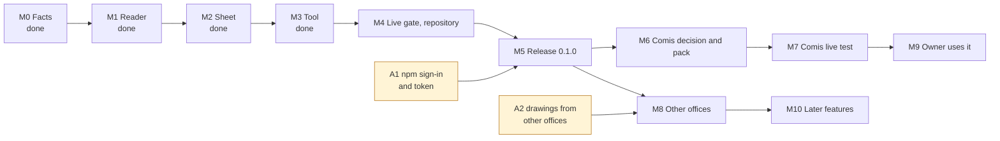

# drawing-axi: master plan

| | |
| --- | --- |
| Status | `drawing-axi` 0.1.4 is on npm with signed provenance. Version 0.2.0 is prepared for release. It is tested on 27 real sheets from three design offices: two offices' plots measure within 10% of people's bills at the default settings; the third office's prints are pictures, and the tool now says so. The Comis apps pack pins it, and a real model through the whole Comis stack drafted a real level's bill of quantities and answered nine Hebrew questions about the drawings. Next: the owner's own install (M9), and the work list in the implementation plan §7.3. |
| Date | 2026-11-20 |
| Design | `drawing-axi-design.md` |
| Implementation plan | `drawing-axi-implementation-plan.md` (tasks T1 to T30, test plan) |
| Live test | `test/live/drawing-live.mjs`; plans and reports stay outside the repository |

## 1. Goal

An owner sends their chief of staff a plumbing or fire-protection drawing and asks for a bill of quantities. A Comis worker reads the drawing with `drawing-axi` and returns a workbook whose every length comes from the file, with its source, and whose gaps are named. The owner checks a draft; they do not start from a blank sheet.

**Done means all six of these hold:**
1. `drawing-live` passes L1 to L9 on real drawings, with every measured system within 10% of a person's takeoff.
2. `drawing-axi` 0.1.0 is on npm with signed provenance.
3. The Comis decision record for shipping it in the apps pack is accepted.
4. The Comis proofs in design §10 (C6) pass, and `pnpm gate` is green on the branch.
5. A real model, asked in the owner's words, produces a takeoff from a made-up sheet whose lengths match the sheet's known answers.
6. The owner has asked their chief of staff for a bill of quantities from a real drawing, and the draft came through Comis.

## 2. Status board

Updated 2026-11-20.

| Area | Status | Evidence |
| --- | --- | --- |
| What CAD-plotted PDFs hold | **Done** | Design §2, F1 to F15, on eight sheets |
| PDF reader | **Done** | Six file shapes read alike; refusals tested |
| Sheet extraction | **Done** | Strokes, fills and comments equal the prototype's counts on real sheets |
| Label decoding | **Done** | A full Hebrew legend and title block read correctly; Latin labels unchanged |
| Scale | **Done** | The bar is found on all eight sheets: 98.7% of 1:100 |
| Runs and sizes | **Done** | 17 of 17 system lengths within 10% of a person's; no size given to fire, water or sprinkler pipe that carries none |
| Legend | **Done** | 12 pipe systems paired with layers on each of eight sheets, with no box given |
| Commands and AXI runtime | **Done** | 123 tests on source, 58 on the built package |
| Damaged and hostile files | **Done** | A fuzz run found one file that never finished; geometry far outside the sheet is now dropped. 4,000 damaged files each end in a known error or a read sheet |
| Skill dry run | **Done** | A worker with only the Comis skill, the tool and the sample sheet got every length right and ignored an instruction planted on the sheet; its notes led to nine fixes in the tool |
| Live gate | **Done on three offices** | Office 1, eight sheets: 61 pass, 0 fail, 11 blocked. Offices 1 and 2, three blind takeoffs of real levels: totals within 1–3% of people's bills; by system within 10% except fire (+16.5%). Office 3, eight sheets: prints whose drawing is pictures, reported as such |
| Repository and CI | **Done** | `comisai/drawing-axi` is public; `main` needs a pull request and green checks on Node 22 and 24; `v*` tags are admin-only; the `npm` environment deploys only from them |
| Release 0.1.0 on npm | **Done** | Published 2026-11-20 by `release.yml` from tag `v0.1.0`. The provenance names this repository, the tag and the workflow. `npm audit signatures` verifies it. The live gate on the installed package: 61 pass, 0 fail, 11 blocked |
| Real-sheet worker run | **Done** | A fresh worker with the released package and the Comis skill drafted a bill of quantities from a real level: 2,290 m in 15 groups, 37 rows, every gap listed. A first run led to ten fixes before the release; the second run's notes are the next version's work list (implementation plan §7.3) |
| Keyed live test in Comis | **Done** | Scenario `drawing-campaign` (comisai/comis#4518), `claude-sonnet-5-5`, record K4518. Run 1: every length right, but the chief of staff declared a Markdown output, so no workbook came back; its delegation guidance was fixed. Run 2: a workbook, five of six rows; a coded label written in a break of a line of another group was kept off that line; fixed in 0.1.1. Run 3: pass, in one minute and USD 0.17 |
| Keyed tests on real drawings | **Done** | Record K4525 (comisai/comis#4525): a real level's two sheets, nine Hebrew questions and a takeoff. Answers right on scale, fire-station count, gas, ceiling height (not on the plan), sprinkler heads (not drawn), the picture plan (refused, CAD plot asked for) and the comparison with the surveyor's workbook; the bill of quantities matched the person's within 3% on five of seven systems. Findings fixed in Comis: the per-call bound for long contexts, a workbook output, citing every file of a request, and handing drawing measures to a worker |
| Release 0.1.1 on npm | **Done** | A label written in a break of a line sizes that line whatever the groups are called; `labels_apart` has one row for each way a label is written. Comis pins 0.1.1 in comisai/comis#4518 |
| Comis pack and skill | **Done** | comisai/comis#4517, merged 2026-11-20: the pack entry pinned to the published checksum, the skill, the decision record, the recorded provenance and the tests. The static gate and the pack stages passed on x64 and arm64 |
| Other design offices | **Done** | Two more offices' drawings came with people's bills (A2). One plots like the first; its findings led to 0.1.2. The other sends prints through a PDF printer, which cannot be measured; the tool says so and asks for the CAD plot |
| Edge cases | **Done** | Every command on truncated, byte-flipped, empty, encrypted and renamed files, a joined two-sheet file, a right-to-left file name and a 200-character name: each ends in a known error in about 0.1 s, or works. The joined file lost its layers; fixed in 0.1.3 |
| Release 0.1.4 | **Released** | Recovers PDF labels with missing or unusable font text maps, including legacy Hebrew fonts. `labels` and its saved JSON report text the reader still cannot decode |
| Release 0.2.0 | **Prepared** | Splits and selects strokes by width and dash pattern, reports discrepancies between the scale bar and stated ratio, renders PNG previews directly, and adds the complete CLI help and output reference |

## 3. Workstreams

| ID | Workstream | Who | Scope |
| --- | --- | --- | --- |
| A | Owner actions | Owner | npm sign-in and token (§7); drawings from other offices; a reference takeoff for them |
| B | AXI build | Developer | Implementation plan T1 to T21 |
| C | Live qualification | Developer, with the owner's drawings | T22, T25, and M8 |
| D | Comis pack | Developer, with Comis reviewers | C1 to C6; T26 to T30 |
| E | Later | Developer and owner | Design §12, phase 5 |

## 4. Milestones and gates

A milestone is done only when its gate passes. Every gate is a command or a proof.

| ID | Milestone | Stream | Depends on | Exit gate | Status |
| --- | --- | --- | --- | --- | --- |
| M0 | Facts from real drawings | C | — | A prototype reads layers, labels and scale from real sheets, and its totals are compared with a person's | **Done 2026-11-20** |
| M1 | The reader | B | M0 | `test/unit/pdf.test.ts` passes: six file shapes, refusals | **Done 2026-11-20** |
| M2 | The sheet | B | M1 | `test/unit/shx.test.ts` and `drawing.test.ts` pass: exact answers on the sample sheet | **Done 2026-11-20** |
| M3 | The tool | B | M2 | `npm run check`, `npm run build`, `npm run test:dist` and `check-package` pass | **Done 2026-11-20** |
| M4 | Live qualification and repository | C | M3 | `npm run live` passes L1 to L9 with every length within 10%; the repository is public with CI green on `main` | **Done 2026-11-20** |
| M5 | Release 0.1.0 | B | M4, A1 | `npm view drawing-axi dist.attestations` names this repository; the live gate passes on the installed package | **Done 2026-11-20** |
| M6 | Comis decision and pack | D | M5 | The decision record, C1 to C5 merged; the pack builds and its doctor finds the exact version; `pnpm gate` green | **Done 2026-11-20** (comisai/comis#4517; static gate and pack stages, see the pull request for the tiers) |
| M7 | Comis live test | D | M6 | C6: a scripted stage with the pack installed; a live scenario in which a real model produces a takeoff of the made-up sheet with every length right; then the owner's run on a test stack with a real drawing | **Live scenario passed 2026-11-20** (comisai/comis#4518, three keyed runs, USD 0.50 in all). The owner's run with a real drawing is M9 |
| M8 | Other offices | C | M5, A2 | The live gate passes on drawings from at least two more design offices, or the gaps are named and `info` reports them | **Done 2026-11-20** (one office measured; one reported as pictures) |
| M9 | The owner uses it | D | M7 | One real bill of quantities drafted through the chief of staff on the owner's own install | After M7 |
| M10 | Later features | E | M8 | Each by demand, with a drawn test and a live check | Later |

## 5. Dependencies

**Critical path, now:** M9, then M8. The package is released, the Comis pack pins it by its npm integrity and checks its provenance, and the live scenario passes.

## 6. Schedule

These are estimates for one developer from 20 November 2026. They exclude review queues.

| Milestone | Target | Holds if |
| --- | --- | --- |
| M0 to M3 | **Done 20 Nov** | |
| M4 | **Done 20 Nov** | |
| M5 | **Done 20 Nov** | |
| M6 | **Done 20 Nov** | |
| M7 | **Done 20 Nov** (the live scenario) | |
| M8 | **Done 20 Nov** | |
| M9 | After M7 | The owner's install has the apps pack |

## 7. Owner actions

**A1. npm, once, about five minutes. Done 2026-11-20.** The release workflow publishes with a token and signs provenance with its own identity.
1. Sign in to npmjs.com with the account that owns `ituran-axi` and `priority-axi`.
2. Create a granular access token with read and write access to **all packages**, so that it may create the new package name `drawing-axi`. A token limited to the two existing packages cannot publish a new one.
3. Store it as the `NPM_TOKEN` secret of this repository's `npm` environment: `gh secret set NPM_TOKEN --env npm --repo comisai/drawing-axi`, then paste the token.
4. Tell the developer. The developer pushes the `v0.1.0` tag; the workflow publishes.

After the first release, the token can be narrowed to this package, or replaced by trusted publishing ([releasing](releasing.md)).

**A2. More drawings.** Plumbing or fire plans as PDF from two or more other design offices, each with a person's lengths for a few systems if any exist. They stay on the owner's machine; the live plan names them by path.

**A3. A real request.** After M7: send a drawing to the chief of staff and ask for a bill of quantities.

## 8. Decisions

| ID | Decision | Chosen | Decides |
| --- | --- | --- | --- |
| N1 | An own PDF reader or a general library | An own reader, about 1,400 lines, no new dependency (design §4, option E) | Developer (decided) |
| N2 | Where sizes come from | Labels written along runs only; a size alone is a tag's (design §7.5). Unlabelled pipe stays unsized. | Developer (decided) |
| N3 | What the tool knows about trades | Nothing. Layer-to-system mapping comes from the legend and the skill. | Developer (decided) |
| N4 | Real drawings in the repository | Never. Tests draw their own sheet. | Developer (decided) |
| N5 | The package name and owner | `drawing-axi`, under `comisai`, public, MIT, as the other two AXIs | Owner (asked for it) |
| C1 | Which Comis pack ships it | The apps pack, beside `priority-axi` and `ituran-axi`: the first owners who need it are the ones who have that pack. A pack of its own can follow if owners without those services ask. | Comis maintainers |
| C2 | Does the skill need a connected service | No. The tool reads a local file. | Comis maintainers |
| W1 | Should the skill draft a Priority order from a takeoff | Offer it only when Priority is connected, as a draft that waits for the owner's card | Owner |

## 9. Live test cadence and rules

**When to run it:**

| Run | Command | Purpose |
| --- | --- | --- |
| While changing the reader, runs, sizes or scale | `npm run live -- --plan <plan>` | Catch a regression on real sheets before review |
| Before each release | `npm run build && npm run live -- --plan <plan>` | Gate M5 and every later release |
| After the release | The same, with the installed package on `PATH` | The published bytes behave like the built ones |
| When a new office's drawings arrive | A new plan file | M8 |

**Rules:**
- **Drawings never enter the repository,** an issue or a pull request. They belong to their makers and their clients.
- **Plans are private.** A plan names files by path and holds a person's numbers.
- **Reports stay private.** They are gitignored, mode 0600, name sheets by position, and hold layer names and numbers.
- **Never in public CI.**
- **A pull request carries the summary line only,** and only if the drawings' owner allows it.

**In Comis (M7):**
- The scripted stage and the live scenario use the made-up sample sheet, so the record can be public.
- The live scenario uses a real model. It runs only with the owner's authorization and a spend ceiling, and writes a record.
- The owner's run with a real drawing happens on a test stack. Its record holds lengths and counts, not the drawing.

## 10. Risks

| ID | Risk | Likelihood | Impact | Mitigation | Owner |
| --- | --- | --- | --- | --- | --- |
| K1 | Other offices' PDFs keep no layers or no stroke-font comments | Medium | High: lengths by colour only, sizes by eye | `info` says so before anything is measured; `layers --split` and `render`; M8 tests it early | Developer, owner |
| K2 | A scaled-down print is measured at its stated scale | Medium | High: every length wrong by one factor | `scale` reports "no scale bar found"; the skill checks one known length first; `--pt-per-m` | Developer |
| K3 | A label is given to the wrong pipe | Medium | Medium: a wrong size on a real length | The fit rule and the group rule (P3 to P5); live L6; `labelled_m` shows how much of a size is direct | Developer |
| K4 | The reader meets a PDF it cannot read | Medium | Low: it refuses, with a `qpdf` command | Fail closed; add the shape to the test writer | Developer |
| K5 | A hostile file exhausts memory or time | Low | Medium | Bounds on bytes, decoded bytes, nesting and coordinates; `COMIS_DEADLINE`; the Comis workbench's own limits | Developer |
| K6 | A drawing's text steers the model | Low | Medium | Text safety; the skill treats labels as data; the draft goes to the owner, and an order waits for the owner's card | Developer |
| K7 | A draft is taken for a checked bill | Medium | High | Every row has a source and a basis; unsized and unmeasured items are listed; the skill says "draft" in its answer | Developer, owner |
| K8 | A client's drawing leaks into a public place | Low | High | N4; the pull request template; reports by position; the plan file outside the repository | Developer |
| K9 | The npm token cannot create a new package | Medium | Low: the release waits | A1 step 2 says what the token needs | Owner |
| K10 | The evidence comes from one office and one project, and layer choices were made with the reference in view | Certain today | Medium | Said in design §2; M8 | Developer |

## 11. Files

| File | Purpose |
| --- | --- |
| `docs/drawing-axi-design.md` | What and why: what the files hold, options, commands, behavior, the Comis changes |
| `docs/drawing-axi-implementation-plan.md` | How: layout, module contracts, tasks T1 to T30, test plan, live test spec |
| `docs/drawing-axi-master-plan.md` | When and who: milestones, gates, owner actions, decisions, risks |
| `docs/recipes.md` | Tested command combinations for common questions |
| `docs/releasing.md` | How a version reaches npm |
| `test/live/drawing-live.mjs` | The live test |
| `test/live/plan.example.json` | The shape of a plan file |
| `test/fixtures/` | The test PDF writer and the sample sheet |
| `src/` | The reader, the sheet functions, the commands and the AXI runtime |
